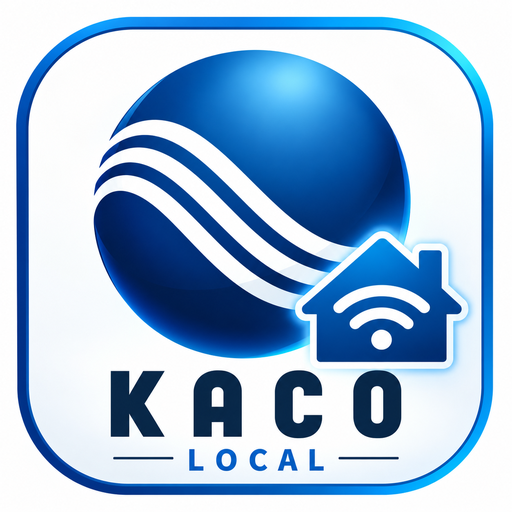

# KACO Local HTTP

**Lokale Home-Assistant-Integration für KACO blueplanet NX1 M2 und NX3 M2 mit M11-WLAN-Kommunikationseinheit.**

**Status:** Community-Projekt, NX1 erprobt; NX3-Unterstützung in Version 2026.10.3 zum Praxistest.  
**Sprache:** Deutsch

> Unabhängiges Community-Projekt, keine offizielle KACO-Integration. KACO und zugehörige Marken gehören den jeweiligen Rechteinhabern. Das Community-Logo ist keine offizielle Freigabe durch KACO.

## Funktionen

- Lokale HTTP-Abfrage ohne Cloud über M11 (Standardport `8484`).
- Einrichtung über **Einstellungen → Geräte & Dienste → Integration hinzufügen**.
- Automatische Modellerkennung anhand des Seriennummernpräfixes `isn` (z. B. `3.0NX1`, `20.0NX3`), statt anhand des nicht eindeutigen `mty`-Codes.
- Einphasige Netzwerte für NX1; bei NX3 zusätzliche Netzspannungs- und Netzstromsensoren für L2 und L3, sofern die API die Werte bei der Einrichtung liefert. Bestehende Sensoren `Netzspannung` und `Netzstrom` bleiben aus Kompatibilitätsgründen die L1-Werte.
- AC-Leistung, Scheinleistung, Blindleistung, Leistungsfaktor, Temperatur, Netzfrequenz, PV1/PV2-Spannung und -Strom, Betriebsstunden, Tages- und Gesamtertrag.
- Diagnose: Verbindung, letzte erfolgreiche Aktualisierung, Fehlercode, Geräteadresse, Ländercode/Netzstandard, Modelltyp, Nennleistung und Peak Shaving/Erweiterung.
- Zwischenspeicherung zuletzt erfolgreicher Messwerte über Home-Assistant-Neustarts hinweg.

**Wichtig:** Offline-0-W ist **keine echte Messung**. Bei Netzwerkstörungen kann der Wechselrichter weiter erzeugen. PV-String-Leistung und String-Erträge werden **nicht geschätzt**.

## Voraussetzungen

- Home Assistant mit Unterstützung für benutzerdefinierte Integrationen.
- KACO blueplanet NX1/NX3 mit erreichbarer lokaler M11-HTTP-Schnittstelle.
- `http://WECHSELRICHTER-IP:8484/getdev.cgi?device=2` muss `inv` mit `isn` liefern.
- Home Assistant und Kommunikationsmodul müssen sich im Netzwerk erreichen können.

Bisher getestet: blueplanet 3.0 NX1 M2 / M11 / Firmware `21618-006R`. Ein externer Tester hat für blueplanet 20.0 NX3 M2 passende HTTP-Datensätze bereitgestellt; die aktualisierte Integration selbst muss noch auf diesem Gerät getestet werden.

## Installation über HACS (benutzerdefiniertes Repository)

1. In **HACS → Drei-Punkte-Menü → Benutzerdefinierte Repositories** öffnen.
2. `https://github.com/hssteuerung/kaco-local-http` eintragen, Typ **Integration** auswählen.
3. **KACO Local HTTP** installieren und Home Assistant neu starten.
4. Unter **Einstellungen → Geräte & Dienste → Integration hinzufügen** nach **KACO Local HTTP** suchen.
5. IP/Hostname und Port (Standard `8484`) eingeben.

Die Menünamen können je nach HACS-Version abweichen. Das Projekt ist nicht automatisch im offiziellen HACS-Katalog gelistet.

## Manuelle Installation

`custom_components/kaco_local_http` nach `/config/custom_components/kaco_local_http` kopieren, Home Assistant neu starten und die Integration einrichten.

## Sensoren und Datenherkunft

| Sensor | HTTP-Feld | Anzeige / Hinweis |
|---|---|---|
| AC-Leistung | `pac` | W; offline Ersatzwert 0 W |
| Scheinleistung | `sac` | VA; offline Ersatzwert 0 VA |
| Blindleistung | `qac` | var |
| Leistungsfaktor | `pf` | `/100` (z. B. 99 → 0,99) |
| Gesamtertrag | `eto` | `/10` kWh, mit KACO-App am NX1 bestätigt |
| Tagesertrag | `etd` | `/10` kWh, mit KACO-App am NX1 bestätigt |
| Betriebsstunden | `hto` | h, ohne Umrechnung; mit KACO-App am NX1 bestätigt |
| Temperatur | `tmp` | `/10` °C |
| Netzfrequenz | `fac` | `/100` Hz |
| Netzspannung L1 | `vac[0]` | `/10` V; bestehende Entität „Netzspannung“ |
| Netzspannung L2/L3 | `vac[1]`, `vac[2]` | `/10` V; nur wenn drei Werte geliefert werden |
| Netzstrom L1 | `iac[0]` | `/10` A; bestehende Entität „Netzstrom“ |
| Netzstrom L2/L3 | `iac[1]`, `iac[2]` | `/10` A; Skalierung geräteabhängig prüfen |
| PV1/PV2 Spannung | `vpv[0/1]` | `/10` V |
| PV1/PV2 Strom | `ipv[0/1]` | `/100` A |
| Fehlercode | `err` | Originalcode |
| Ländercode / Netzstandard | `safety` | Zuordnungstabelle, soweit bekannt; keine Schreibfunktion |
| Modelltyp | `isn` | Modellpräfix aus Seriennummer; `mty` als Attribut `originalcode` |
| Nennleistung | `rate` | W |
| Peak Shaving / Erweiterung | `psb_eb` | Originalwert; genaue Semantik nicht bestätigt |

**Hinweis zu NX3:** Der externe 20.0-NX3-Testdatensatz liefert `mty: 51`, obwohl dieser Wert bisher als NX1-Modell interpretiert wurde. `mty` ist deshalb nicht als eindeutige Modellkennung geeignet. Die Zuordnung von Netzstromwerten zu tatsächlichen Ampere ist am NX3 noch nicht unabhängig bestätigt.

## Datenschutz und Sicherheit

Die Integration nutzt die lokale HTTP-Adresse ohne Cloud-Zugangsdaten. HTTP ist **unverschlüsselt**: nur im vertrauenswürdigen LAN verwenden und Port 8484 nicht ins Internet freigeben. Registrierungscodes, Tokens und öffentliche IP-Adressen vor dem Teilen von Logs schwärzen.

## Fehlerbehebung

- **Nicht gefunden:** IP, Port und `getdev.cgi?device=2` prüfen.
- **Offline:** WLAN/Kommunikationsmodul prüfen; letzte Messwerte bleiben ggf. gespeichert.
- **0 W trotz Sonne:** Verbindung prüfen; Offline-0-W ist ein Ersatzwert.
- **NX3 zeigt nur L1:** Prüfen, ob `vac`/`iac` beim Start drei Werte liefern; Home Assistant nach Update neu starten.
- **Logo fehlt:** Home Assistant und HACS verwalten Branding teilweise separat.

## Mitwirken

Fehlerberichte bitte mit HA-Version, Modell, M11-Firmware, reproduzierbaren Schritten und anonymisierten Logs einreichen. Siehe [CONTRIBUTING.md](CONTRIBUTING.md).

## Lizenz

Quellcode unter [MIT-Lizenz](LICENSE). Marken- und Logo-Rechte verbleiben bei ihren Inhabern.
